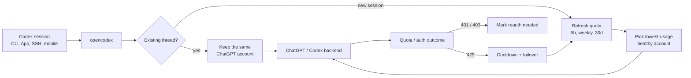

<h3 align="center">make codex open!</h3>
<p align="center"><b>Універсальний проксі провайдерів для OpenAI Codex &amp; Claude Code</b> — використовуйте будь-яку LLM з Codex CLI, App, SDK та Claude Code.</p>
<p align="center"><code>npm install -g @bitkyc08/opencodex</code> · <code>ocx start</code> · <b>localhost:10100</b></p>

<p align="center">
  <a href="https://www.npmjs.com/package/@bitkyc08/opencodex"></a>
  <a href="https://github.com/lidge-jun/opencodex/blob/main/LICENSE"></a>
  
</p>

<p align="center">
  
</p>

<p align="center">
  <a href="README.md">English</a> · <a href="README.ko.md">한국어</a> · <a href="README.zh-CN.md">简体中文</a> · <a href="README.ru.md">Русский</a> · <a href="README.ja.md">日本語</a> · <b>Українська</b> · 📖 <a href="https://lidge-jun.github.io/opencodex/uk/"><b>Повна документація →</b></a>
</p>

<p align="center">
  
</p>

Використовуйте Claude, Gemini, Grok, GLM, DeepSeek, Kimi, Qwen, Ollama або будь-яку іншу LLM з Codex — і з **Claude Code** — не чекаючи, поки хтось додасть підтримку.

opencodex — це легкий локальний проксі, який транслює Responses API від Codex у той протокол, яким «розмовляє» ваш провайдер. Потокова передача, виклики інструментів, токени міркувань, зображення — усе працює в обох напрямках.

<p align="center">
  
</p>
<p align="center"><sub><b>Codex на будь-якій моделі.</b> Виберіть провайдера — і вперед: той самий робочий процес Codex, інший «мозок».</sub></p>

Крім того, opencodex вміє керувати **пулом акаунтів ChatGPT** для автентифікації Codex. Додайте кілька
акаунтів ChatGPT / Codex, оновлюйте їхні квоти (5 год / тиждень / 30 днів) у панелі керування — і нові
сесії автоматично спрямовуватимуться на працездатний акаунт із найменшим використанням. Наявні треди
Codex залишаються прив'язаними до акаунта, з якого вони почалися, тож тривалі сесії через SSH, у tmux
чи з мобільного пристрою не перемикаються між акаунтами посеред розмови.

```
Codex CLI / App / SDK ──/v1/responses──▶ opencodex ──▶ Any provider
                                              │
              Anthropic · Google · xAI · Kimi · Ollama Cloud · Groq
              OpenRouter · Azure · DeepSeek · GLM · …and OpenAI itself
```



## Підтримувані платформи

| ОС | Статус | Менеджер служб |
|---|---|---|
| macOS (arm64 / x64) | Повна підтримка | launchd |
| Linux (x64 / arm64) | Повна підтримка | systemd (користувацький юніт) |
| Windows (x64) | Повна підтримка | Task Scheduler (прихований) / опційна нативна служба (`--native`, WinSW) |

Потрібен [Node](https://nodejs.org) 18+. Середовище виконання Bun встановлюється автоматично під час `npm install` — окремо ставити Bun не потрібно. Усі три платформи працюють нативно (на Windows WSL не потрібен).

## Швидкий старт

```bash
# Встановлення (Bun-середовище встановлюється автоматично — потрібен лише Node 18+)
# Віддавайте перевагу Node, встановленому користувачем (nvm/fnm) — уникайте `sudo npm install -g …`
npm install -g @bitkyc08/opencodex

# Інтерактивне налаштування (записує конфіг, інтегрує в Codex і пропонує встановити shim для автозапуску)
ocx init

# Запуск проксі
ocx start

# Якщо ви пропустили цей крок під час init, встановіть shim автозапуску за потреби пізніше
ocx codex-shim install

# Користуйтеся Codex як звичайно — тепер він маршрутизується через opencodex
codex "Write a hello world in Rust"
```

<details>
<summary><b>«bundled Bun runtime is missing» / npm заблокував install-скрипти Bun?</b></summary>

<br/>

opencodex постачає середовище виконання Bun як залежність і запускає його через Node-лаунчер, тож вам
**не** потрібно встановлювати Bun самостійно. Якщо ви бачите помилку «bundled Bun runtime is missing»,
це означає, що встановлення пропустило lifecycle-скрипти (зокрема через блокування npm-ом postinstall
від bun у режимі `allowScripts`) або опційні залежності. Перевстановіть без цих прапорців, дозволивши
install-скрипт bun:

```bash
npm install -g --allow-scripts=bun @bitkyc08/opencodex   # без --ignore-scripts, без --omit=optional

# якщо початкове встановлення використовувало sudo, продовжуйте користуватися sudo:
sudo npm install -g --allow-scripts=bun @bitkyc08/opencodex
```

Власне попередження npm пропонує скорочену команду без імені пакета — але вона перевстановила б поточну
директорію, тож завжди явно вказуйте `@bitkyc08/opencodex`.

Якщо ви встановлювали з `sudo` у префікс, що належить root, наведена вище перевстановка з sudo
розблоковує цей префікс — але за можливості переходьте на Node, встановлений користувачем (nvm, fnm або
користувацький npm-префікс).

</details>

## Додавання провайдера

Найшвидший спосіб додати провайдера — через веб-панель:

```bash
ocx gui
```

Ця команда відкриває панель за адресою `http://localhost:10100`. Звідти:

1. Натисніть **«Add Provider»**
2. Виберіть один із **40+ вбудованих провайдерів** — або введіть власний OpenAI-сумісний ендпоінт
3. Вставте свій API-ключ (або увійдіть через OAuth для Anthropic, xAI та Kimi)
4. Моделі **виявляються автоматично** з ендпоінта провайдера `/v1/models`

Ваш новий провайдер готовий до використання одразу. Перезапуск не потрібен.

Провайдерів також можна додати через `ocx init` (інтерактивний CLI) або безпосередньо редагуючи `~/.opencodex/config.json`.

## Маршрутизація моделей

Звертайтеся до будь-якого налаштованого провайдера й моделі за синтаксисом `provider/model`:

Провайдери, чиї власні ідентифікатори моделей містять `/` (zenmux, openrouter, nvidia, …), надаються
Codex із внутрішніми слешами, заміненими на `-` (наприклад, `zenmux/moonshotai-kimi-k3-free`); проксі
прозоро повертає їх до нативного ідентифікатора, і сирий формат із повними слешами теж продовжує
працювати.

```bash
# Використати Claude Opus через Anthropic
codex -m "anthropic/claude-opus-5" "Explain this stack trace"

# Використати Gemini через Google
codex -m "google/gemini-3-pro" "Write unit tests for auth.ts"

# Використати GLM через Ollama Cloud
codex -m "ollama-cloud/glm-5.2" "Write a SQL migration"

# Використати локальну модель через Ollama
codex -m "ollama/llama3" "Refactor this function"
```

Коли ви опускаєте префікс `provider/`, opencodex маршрутизує до провайдера за замовчуванням — або автоматично зіставляє за шаблоном імені моделі (наприклад, `claude-*` спрямовується до Anthropic, `gpt-*` — до OpenAI).

Combo-аліаси — це точні публічні ідентифікатори моделей; вони можуть бути звичайними іменами або
використовувати власний простір імен. Якщо combo-аліас точно збігається з налаштованим селектором
`provider/model` для не-OpenAI, combo навмисно має пріоритет у маршрутизації, `/v1/models` та каталозі
Codex. Перейменування цього аліаса або видалення combo одразу відновлює фізичний селектор провайдера.

Маршрутизовані моделі також з'являються в селекторі моделей **Codex App** із покерувами зусиллям міркувань для кожної моделі:

Сучасні збірки Codex можуть надавати елементи керування зусиллям міркувань `low`, `medium`, `high`,
`xhigh`, `max` та `ultra`, коли модель їх оголошує. opencodex тримає `xhigh` та `max` окремими, доки
конфіг провайдера явно не зіставить одне з одним. `ultra` віддзеркалює семантику вихідного Codex: воно
вибирає максимальні міркування плюс проактивне мультиагентне делегування в клієнті і перетворюється на
`max` перед тим, як будь-який запит досягне провайдера. Маршрутизовані моделі оголошують його лише
тоді, коли конфіг провайдера підключається через `reasoningEfforts`.

GPT-5.6 Sol/Terra/Luna додано як готові до розгортання записи каталогу для пресетів OpenAI API-ключа та
OpenRouter (`gpt-5.6-sol`, `gpt-5.6-terra`, `gpt-5.6-luna`; OpenRouter використовує `openai/...`). Вони
залишаються заблокованими на етапі попереднього доступу залежно від доступності з боку вихідного
провайдера; opencodex лише готує маршрутизацію та метадані каталогу для акаунтів і провайдерів, які
можуть їх обслуговувати.

<p align="center">
  
</p>

## Режими акаунтів провайдера OpenAI

| ID провайдера | Маршрут | Обліковий запис | Поведінка |
|---|---|---|---|
| `openai` | Вхід у Codex | Основний + додані акаунти Codex | Пул за замовчуванням; опційний режим Direct |
| `openai-apikey` | OpenAI API | API-ключ / пул ключів | Без маршрутизації акаунтів Codex |

- Пул включає основний вхід у Codex та додані акаунти з афінністю, квотою, кулдауном і фейловером.
- Direct обходить стан пулу й використовує лише bearer поточного викликача / основного входу.
- Свіжі встановлення та конфіги без збереженого режиму за замовчуванням використовують Pool. Змініть
  режим на сторінці **Providers** у панелі; ідентифікатори моделей залишаються без префікса в будь-якому режимі.
- Застарілий публічний ідентифікатор провайдера `chatgpt` приховується після міграції. Оригінальний
  конфіг зберігається один раз у `~/.opencodex/config.json.pre-openai-tiers-v2.bak`; відновіть його
  командою `cp ~/.opencodex/config.json.pre-openai-tiers-v2.bak ~/.opencodex/config.json`.
- Поточні конфіги використовують `openaiProviderTierVersion: 2`. Ранні конфіги v1 із трьома
  провайдерами мігрують автоматично в єдиний рядок `openai`.
- Тариф API включає Pro-віртуальні моделі (`gpt-5.6-sol-pro`, `gpt-5.6-terra-pro`,
  `gpt-5.6-luna-pro`). На рівні протоколу кожна з них перетворюється на свою базову модель з
  `reasoning.mode: "pro"`.
- Її каталог зафіксовано на восьми ідентифікаторах: `gpt-5.5`, `gpt-5.6`, Sol/Terra/Luna та три
  відповідні Pro-віртуальні ідентифікатори. Загального аліаса `gpt-5.6-pro` немає.
- Compact-запити зберігають вибраний тариф, але надсилають базову модель без об'єкта міркувань.
- Офіційні метадані API — 1 050 000 токенів контексту та 922 000 максимальних вхідних токенів.

Використовуйте `gpt-5.6-sol` для налаштованого режиму акаунта `openai` та `openai-apikey/gpt-5.6-sol`
для API-ключа. Облікові дані входу в Codex та API ніколи не перетікають одні в одні.

### Поведінка акаунтів у пулі

Відкрийте **Codex Auth** у панелі, щоб додати акаунти й вибрати, який акаунт має обробляти наступну
сесію Codex. opencodex зберігає таку поведінку:

- **Наявні сесії зберігають афінність.** Ідентифікатор треда прив'язується до вибраного акаунта й
  повторно використовується на подальших кроках, тож тривалий запит або сесія, під'єднана через
  mobile/SSH, продовжує використовувати той самий акаунт.
- **Нові сесії можуть маршрутизуватися автоматично.** Коли автоперемикання ввімкнене, opencodex
  порівнює найзавантаженіше відоме вікно квоти серед 5 год, тижневого й 30-денного використання, потім
  вибирає прийнятний акаунт з меншим використанням для нових сесій, щойно активний акаунт перетне поріг.
- **Пошук квоти вбудований.** Панель може оновити квоти всіх акаунтів одним кліком, а журнал запитів
  позначає трафік пулу порядковими номерами акаунтів без PII.
- **Збої «падають закрито».** Збої токена позначають потребу повторної автентифікації замість тихого
  переходу на інші облікові дані; відповіді 429 про квоту переводять акаунт у кулдаун і можуть
  перекинути майбутню роботу на інший прийнятний акаунт пулу.

## Ключові можливості

- **Використовуйте будь-яку LLM з Codex.** 5 протокольних адаптерів охоплюють Anthropic Messages, Google Gemini, Azure, наскрізний OpenAI Responses та кожен OpenAI-сумісний ендпоінт Chat Completions — це 40+ провайдерів «з коробки».
- **Використовуйте будь-яку LLM і з Claude Code.** Той самий демон обслуговує Anthropic Messages API (`/v1/messages` + `count_tokens`): `ocx claude` запускає Claude Code повністю налаштованим, а маршрутизовані моделі з'являються в його нативному селекторі `/model` через виявлення моделей шлюзу (аліаси `claude-ocx-<provider>--<model>`, Claude Code 2.1.129+). Налаштуйте слоти та мапи моделей на сторінці Claude у панелі.
- **Використовуйте будь-яку LLM і з GitHub Copilot App.** Спрямуйте Model providers у Copilot на `http://127.0.0.1:10100/v1` — OpenCodex обслуговує OpenAI-сумісні `GET /v1/models` та `POST /v1/chat/completions`, тож маршрутизовані моделі синхронізуються в застосунок. Див. [docs/github-copilot-app.md](docs/github-copilot-app.md).
- **Безпечно об'єднуйте акаунти ChatGPT в пул.** Тримайте наявні треди Codex на одному акаунті, поки
  нові сесії можуть автоматично вибрати акаунт із меншим використанням із пулу, з оновленням квоти та
  позначками запитів без PII.
- **Увійдіть один раз — пропустіть API-ключ.** Підтримка OAuth для xAI, Anthropic та Kimi означає, що ви можете автентифікуватися наявним акаунтом. Токени оновлюються автоматично. Або перенаправте свій `codex login`, вставте API-ключ чи використайте посилання `${ENV_VAR}` — на ваш вибір.
- **Працює всюди, де працює Codex.** Автоматично інтегрується в Codex CLI, TUI, App і SDK. Маршрутизовані моделі з'являються в селекторі моделей Codex так само, як нативні.
- **Інтеграція, безпечна для історії.** На локальних встановленнях проксі спрямовує власного вбудованого провайдера `openai` у Codex на самого себе єдиним рядком `openai_base_url` — нові треди зберігають свій нативний тег провайдера, тож поточна історія чату ніколи не перемапується, і брудне завершення не може її приховати. (Треди, перепозначені старішими версіями, один раз мігрують назад під час першого запуску; віддалені/LAN-прив'язки натомість використовують окремий запис провайдера, оскільки їм потрібен заголовок з API-ключем.)
- **Делегуйте потрібній моделі.** Виведіть до п'яти маршрутизованих або нативних моделей у селектор субагентів Codex із панелі чи конфіга — спрямовуйте складні задачі до моделі міркувань, швидкі — до дешевої. На поверхні мультиагента v2 (GPT-5.6 Sol/Terra) проксі впроваджує компактну, схемонезалежну настанову з делегування: прийнятну бажану модель субагента й зусилля (`injectionModel` / `injectionEffort`), налаштований перетин перших п'яти видимих у селекторі Codex, сумісних з v2, відсортованих за пріоритетом моделей із доступними драбинами зусиль, та правила `fork_turns`, що дозволяють міжмодельним викликам `spawn_agent` застосовувати свої перевизначення. Відоме обмеження: коли нативний батько породжує маршрутизовану дитину, тіло задачі наразі може прибувати зашифрованим бекендом і губитися ([#92](https://github.com/lidge-jun/opencodex/issues/92)) — для надійного міжпровайдерного делегування використовуйте поверхню v1. Хочете власне формулювання? Задайте `injectionPrompt` з плейсхолдерами `{{model}}` / `{{effort}}` / `{{roster}}`.
- **Готуйтеся до заблокованих на прев'ю розгортань OpenAI.** Записи GPT-5.6 Sol/Terra/Luna зберігають вихідні драбини зусиль. Direct/Multi використовують контракт Codex на 372k; OpenAI API та OpenRouter використовують метадані 1.05M, коли доступ з боку вихідного провайдера доступний.
- **Дайте будь-якій моделі суперсили.** Не-OpenAI моделі отримують справжній вебпошук і розуміння зображень через sidecar `gpt-5.4-mini` поверх вашого входу в ChatGPT.
- **Генеруйте зображення нативно.** Автономний інструмент Codex `image_gen` використовує `POST /v1/images/generations` для генерації та `POST /v1/images/edits` для редагувань; він окремий від хостованого інструмента Responses `image_generation`.
- **Бачте, що відбувається.** Веб-панель показує провайдерів, статус OAuth, вибір моделі та живий журнал запитів, зокрема кількість токенів кешу/запису в кеш, коли вихідний провайдер про них повідомляє — більше не потрібно гадати, чому запит не вдався.
- **Працює у фоні.** Встановіть як системну службу (launchd / systemd / Task Scheduler) і забудьте про неї. На macOS/Linux проксі стартує при вході; на Windows типовий бекенд Task Scheduler стартує при вході (без вікна), або використайте `ocx service install --native` для справжньої служби Windows, що стартує під час завантаження.
- **Чистий вихід, нуль залишків.** `ocx stop` (або кнопка Stop у панелі) вимикає проксі, зупиняє фонову службу, якщо її встановлено, і відновлює оригінальну конфігурацію Codex. Звичайний `codex` працює точно так, як раніше — без залишкового конфіга, без осиротілих процесів.

## Провайдери та адаптери

| Провайдер | Адаптер | Автентифікація |
|---|---|---|
| OpenAI (вхід у ChatGPT) | `openai-responses` | forward (без ключа) |
| OpenAI (API-ключ) | `openai-responses` | key |
| Umans AI Coding Plan | `anthropic` | key |
| Anthropic Claude | `anthropic` | oauth / key |
| xAI Grok | `openai-chat` | oauth / key |
| Kimi (Moonshot) | `openai-chat` | oauth / key |
| Google Gemini | `google` | key |
| Azure OpenAI | `azure-openai` | key |
| Cursor (експериментально) | `cursor` | dashboard/локальний конфіг; живий транспорт; небезпечний нативний локальний exec вмикається опційно |
| Ollama Cloud + каталог із 17 провайдерів | `openai-chat` | key |
| Ollama / vLLM / LM Studio (локально) | `openai-chat` | key (зазвичай порожній) |
| Будь-який OpenAI-сумісний ендпоінт | `openai-chat` | key |

Плюс DeepSeek, Groq, OpenRouter, Together, Fireworks, Cerebras, Mistral, Hugging Face, NVIDIA NIM, MiniMax, Qwen Cloud, Tencent Cloud Coding Plan, SiliconFlow та інші. Дивіться повний список через `ocx init` або в [документації провайдерів](https://lidge-jun.github.io/opencodex/reference/configuration/).

Підтримка Cursor — це поетапний експериментальний міст: він з'являється в `ocx init` та в селекторі Add
Provider панелі як локальний конфіг зі статичним публічним каталогом моделей Cursor. Живий транспорт
HTTP/2 вмикається, коли налаштовано токен доступу Cursor. Керована сервером нативна виконавча
функціональність Cursor read/write/delete/ls/grep/shell/fetch вимкнена за замовчуванням, бо вона обходить
шлях затвердження й пісочниці Codex. Текст запиту, як-от маркер пісочниці Codex `danger-full-access`,
ніколи не авторизує нативний локальний exec; встановлюйте `nativeLocalExec: "on"` лише для довірених
локальних експериментів, де кожен викликач data-plane є довіреним. `nativeLocalExec: "codex-sandbox"`
приймається задля зворотної сумісності, але «падає закрито», як `off`; застаріле
`unsafeAllowNativeLocalExec: true` залишається явним opt-in для оператора.
MCP, запис екрана та computer-use надаються через executor-хуки; коли локальний executor не
налаштований, opencodex повертає типізовані результати no-executor замість блокування запиту політикою.
OAuth Cursor та живе виявлення моделей увімкнені для експериментального адаптера Cursor.

## CLI

```bash
ocx init                       # інтерактивне налаштування
ocx start [--port 10100]       # запустити проксі; переходить на вільний порт, якщо зайнято
ocx stop                       # зупинити + відновити нативний Codex
ocx restore                    # відновити без зупинки (аліас: ocx eject)
ocx uninstall                  # видалити службу/shim/конфіг і відновити нативний Codex
ocx ensure                     # запустити за потреби + оновити конфіг/кеш Codex
ocx sync                       # оновити моделі + повторно інтегрувати в Codex
ocx codex-shim install         # запускати `ocx ensure` щоразу під час запуску `codex`
ocx status                     # чи запущено проксі?
ocx login <provider>          # вхід через OAuth (xai, anthropic, kimi, cursor, ...)
ocx logout <provider>          # видалити збережений вхід
ocx account <list|current|use> # список/перемикання акаунтів і пулів API-ключів (маскованих; також refresh/auto-switch/remove/add-key)
ocx gui                        # відкрити веб-панель
ocx claude [args...]           # запустити Claude Code, під'єднаний до проксі (виявлення моделей увімкнено)
ocx service [install|start|stop|status|uninstall]   # встановити/оновити/запустити фонову службу
ocx update [--tag preview]     # оновити opencodex; preview-встановлення залишаються на @preview
```

### Автозапуск: служба чи shim

opencodex має два способи автоматичного запуску проксі:

| | `ocx service` / `ocx service install` | `ocx codex-shim install` |
|---|---|---|
| **Як** | Менеджер служб ОС (launchd / systemd / schtasks) | Обгортає скрипт-лаунчери для `codex`; справжній `codex.exe` не чіпається |
| **Коли** | Завжди працює після входу | За потреби — запускає `ocx ensure`, коли запускається `codex` |
| **Перезапуск** | Автоперезапуск після збою | Стартує один раз на кожен виклик `codex` |
| **Оновлення Codex** | Не впливає | Ремонтується під час наступного `ocx codex-shim install` або `ocx update` |
| **Видалення** | `ocx service uninstall` | `ocx codex-shim uninstall` |

Використовуйте **службу** для завжди ввімкненого проксі (рекомендовано для машин розробки). Використовуйте
**shim** для легкого запуску проксі за потреби без фонового демона. Автозапуск shim увімкнено за
замовчуванням і його можна вимкнути з панелі GUI. Якщо налаштований порт проксі вже зайнятий, `ocx start`
автоматично вибирає інший вільний локальний порт і оновлює Codex, щоб використовувати його.

### Видалення

Перед видаленням npm-пакета очистіть локальний стан:

```bash
ocx uninstall
npm uninstall -g @bitkyc08/opencodex
```

`ocx uninstall` зупиняє проксі, видаляє будь-яку встановлену службу, видаляє shim Codex, відновлює
нативні конфіг/каталог/історію Codex та видаляє `~/.opencodex`.

## Конфігурація

Конфіг знаходиться в `~/.opencodex/config.json`. Якщо файл не вдається розпарсити (наприклад, обрізаний
або зламаний вручну JSON), opencodex створює резервну копію `config.json.invalid-<timestamp>`, виводить
попередження й повертається до типових значень — тож ваш оригінальний файл ніколи не втрачається тихо.

Ось типове налаштування з кількома провайдерами:

```json
{
  "port": 10100,
  "defaultProvider": "anthropic",
  "providers": {
    "anthropic": {
      "adapter": "anthropic",
      "baseUrl": "https://api.anthropic.com",
      "authMode": "oauth",
      "defaultModel": "claude-sonnet-4-6"
    },
    "ollama-cloud": {
      "adapter": "openai-chat",
      "baseUrl": "https://ollama.com/v1",
      "apiKey": "${OLLAMA_API_KEY}",
      "defaultModel": "glm-5.2"
    }
  }
}
```

Записи провайдерів також можуть анотувати метадані маршрутизованого каталогу та значення виводу за
замовчуванням. Використовуйте `contextWindow` для видимого в Codex обмеження контексту на рівні
провайдера, `modelContextWindows` для обмежень окремих моделей та `modelInputModalities` для
модельно-специфічних підказок каталогу щодо вводу, як-от `["text"]` чи `["text", "image"]`. Для моделей
Responses, що відхиляють поля доставки резюме міркувань Codex, встановіть
`modelSupportsReasoningSummaries.<model-id>` у `false`; це оновлює каталог і прибирає застарілі поля
доставки резюме на межі адаптера. Для OpenAI-сумісних chat-провайдерів, чий типовий бюджет відповіді з
боку вихідного провайдера замалий, встановіть `defaultMaxOutputTokens` або per-model
`modelMaxOutputTokens`; явний `max_output_tokens` від клієнта все одно має пріоритет, а конфіги без
значення все одно опускають `max_tokens`. Значення контексту обмежують живі метадані `/models`; вони
ніколи не піднімають менше живе вікно контексту. Вбудовані резервні метадані GPT-5.6 Sol/Terra/Luna
використовують вікно контексту 1 050 000 токенів для записів каталогу OpenAI API-ключа та OpenRouter;
вони не обходять доступ до прев'ю з боку вихідного провайдера. Повний перелік полів дивіться в довіднику
конфігурації.

> **GLM-5.2 з контекстом 1M через Z.AI:** через адаптер `openai-chat` працюють як `glm-5.2`, так і
> `glm-5.2[1m]` — opencodex прибирає завершальний суфікс `[1m]` перед надсиланням запиту, оскільки
> OpenAI-сумісні ендпоінти відхиляють ідентифікатор із дужками (Z.AI 400 код 1211). Суфікс `[1m]` — це
> конвенція Claude-Code / Anthropic-ендпоінта; щоб використати його нативно, спрямуйте адаптер
> `anthropic` на coding-базу Z.AI (`https://api.z.ai/api/coding/paas/v4`). Задайте вікно контексту 1M
> через каталог моделей (`modelContextWindows`), а не через ім'я моделі.

Локальні моделі теж працюють. Спрямуйте opencodex на будь-який OpenAI-сумісний сервер, що працює на
вашій машині:

```json
{
  "port": 10100,
  "defaultProvider": "ollama",
  "providers": {
    "ollama": {
      "adapter": "openai-chat",
      "baseUrl": "http://localhost:11434/v1",
      "authMode": "key",
      "apiKey": "",
      "defaultModel": "llama3"
    },
    "vllm": {
      "adapter": "openai-chat",
      "baseUrl": "http://localhost:8000/v1",
      "authMode": "key",
      "apiKey": "",
      "defaultModel": "Qwen/Qwen3-32B"
    }
  }
}
```

Транспорт WebSocket вимкнено за замовчуванням. Встановлюйте `"websockets": true` лише якщо хочете, щоб Codex оголошував і використовував шлях Responses через WebSocket замість HTTP/SSE.

### Віддалений доступ

За замовчуванням opencodex прив'язується до `127.0.0.1` (loopback) і не потребує додаткової
автентифікації. Якщо ви встановите `"hostname": "0.0.0.0"`, щоб виставити проксі в LAN, opencodex вимагає
bearer-токен для захисту як управлінського API (`/api/*`), так і data-plane (`/v1/responses`,
`/v1/images/generations` та `/v1/images/edits`):

```bash
export OPENCODEX_API_AUTH_TOKEN="your-secret-token"
ocx start
```

Проксі відмовляється стартувати без цієї змінної під час прив'язки поза loopback. Якщо ви встановлюєте
фонову службу для доступу в LAN, експортуйте цю саму змінну перед `ocx service install`, щоб менеджер
служб її отримав.
Клієнти (скрипти, віддалені машини) мають включати токен у кожен запит:

```
x-opencodex-api-key: your-secret-token
```

Токен порівнюється за сталий час, щоб запобігти атакам за часом.

opencodex автоматично перемапує історію відновлення Codex, щоб старі чати OpenAI та створені opencodex
проєктні треди залишалися видимими в Codex App, поки проксі активний. opencodex записує оригінальні
метадані провайдера/джерела у `~/.opencodex/codex-history-backup.json`. `ocx stop` / `ocx restore`
відновлюють збережені рядки OpenAI назад до OpenAI, а також вивільняють будь-які треди користувача, що
залишилися в opencodex, назад до OpenAI, щоб нативний Codex не намагався відновити тред, чий провайдер
більше не існує в `config.toml`.

Якщо ви тестували старішу збірку розробки, де `syncResumeHistory` уже перемапував історію до появи
підтримки резервного копіювання, ви також можете виконати явну команду відновлення:

```bash
ocx recover-history --legacy-openai
```

Дивіться **[Довідник конфігурації](https://lidge-jun.github.io/opencodex/reference/configuration/)** для кожного поля.

## Документація

Публічна документація — встановлення, провайдери, маршрутизація, sidecar-и, інтеграція з Codex, селектор моделей Codex App і довідник CLI/конфігурації — збирається з [`docs-site/`](./docs-site) і публікується на **[lidge-jun.github.io/opencodex](https://lidge-jun.github.io/opencodex/)**.

Нотатки-джерело правди від супроводжувачів живуть у [`structure/`](./structure). Історичні дослідження залишаються в [`docs/`](./docs).
Налаштування для контриб'юторів описано в [`CONTRIBUTING.md`](./CONTRIBUTING.md), а настанови щодо звітування про безпеку — у [`SECURITY.md`](./SECURITY.md).

## Розробка

```bash
git clone https://github.com/lidge-jun/opencodex.git
cd opencodex
bun install
bun run dev:proxy    # запустити proxy API в режимі розробки
bun run dev:gui      # запустити dev-сервер панелі в іншому терміналі
bun x tsc --noEmit   # перевірка типів
```

`bun run dev` залишається аліасом для `bun run dev:proxy` задля сумісності. У вихідному checkout proxy API
надає `/healthz`, `/v1/responses`, `POST /v1/images/generations`, `POST /v1/images/edits` та `/api/*`;
`GET /` обслуговує запаковану панель лише після того, як `bun run build:gui` створить `gui/dist`. Під час
роботи над панеллю запускайте фронтенд окремо:

```bash
bun run dev:gui
```

Дивіться **[Contributing](./CONTRIBUTING.md)**.

## Застереження

opencodex — незалежний проєкт, що підтримується спільнотою, і **не пов'язаний з OpenAI, Anthropic чи будь-яким іншим провайдером і не схвалений ними**.

Деякі провайдери — зокрема Anthropic (Claude) — можуть призупиняти або обмежувати акаунти, що маршрутизують API-трафік через сторонні проксі. **Використовуйте на власний ризик (UAYOR).** Перед під'єднанням провайдера перегляньте його Умови надання послуг, щоб підтвердити, що доступ через проксі дозволено. Супроводжувачі opencodex не відповідають за жодні дії щодо акаунтів з боку вихідних провайдерів.

## Ліцензія

MIT
